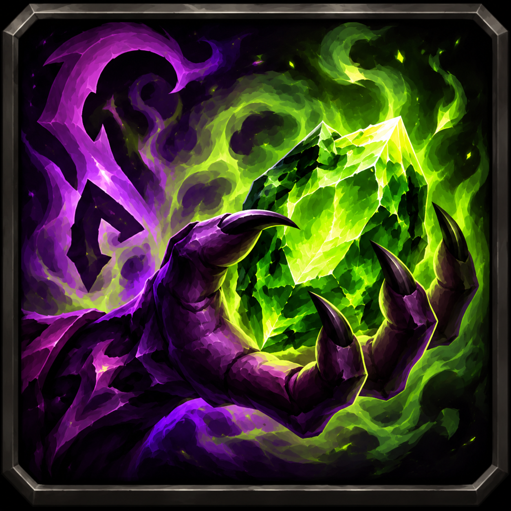

<p align="center"></p>

<h1 align="center">Warlock Toolkit</h1>

<p align="center">
  Reminders and one-click buttons for Warlocks in <b>World of Warcraft: Forever</b><br>
  armor · Soul Shards · Healthstone · Soulstone · demon
</p>

<p align="center">
  <b>English</b> · <a href="README_UA.md">Українська</a>
</p>

---

## Contents

- [Overview](#overview)
- [Supported clients](#supported-clients)
- [Installation](#installation)
- [Features](#features)
  - [Armor](#1-armor)
  - [Soul Shards](#2-soul-shards)
  - [Healthstone](#3-healthstone)
  - [Soulstone](#4-soulstone)
  - [Demon](#5-demon)
- [Look and behavior](#look-and-behavior)
  - [Highlight](#highlight)
  - [Opacity and combat](#opacity-and-combat)
  - [Snapping](#snapping)
  - [Background](#background)
  - [Sounds](#sounds)
- [Controls](#controls)
  - [Commands](#commands)
  - [Minimap button](#minimap-button)
  - [Moving elements](#moving-elements)
- [Client limitations](#client-limitations)
- [Project structure](#project-structure)
- [Releasing](#releasing)
- [License](#license)
- [Changelog](CHANGELOG.md)

## Overview

| | |
|---|---|
| **Clients** | WoW Forever, Classic Era, TBC Anniversary, Mists of Pandaria Classic, Retail ([details](#supported-clients)) |
| **Class** | Warlock only. On any other class the addon creates nothing and stays fully disabled |
| **Version** | 1.0.0 |

The addon shows an icon only when something is missing: armor, shards, stones or your demon.
Clicking the icon fixes it right away.

Every feature can be turned on or off individually. Every icon can be:

- resized, moved and locked in place;
- given a highlight (color; enabled by default);
- given a sound.

## Supported clients

One addon folder works on every client: the TOC lists all interface versions
(`## Interface: 120105, 50504, 20506, 11509, 16001`). The addon adapts to what the client has:

| Client | Interface | Differences |
|--------|-----------|-------------|
| WoW Forever | 16001 | Everything as described below |
| Classic Era | 11509 | Everything as described below |
| TBC Anniversary | 20506 | Fel Armor is cast instead of Demon Armor once learned; Master stones; Felguard |
| Mists of Pandaria Classic | 50504 | No armor icon. No shard counter: Soul Shards are a resource with the game's own UI. Soulstone is cast directly on the target. Grimoire of Supremacy demons replace the regular ones |
| Retail (Midnight) | 120105 | No armor icon. No shard counter: Soul Shards are a resource with the game's own UI. Soulstone is cast directly on the target (15 min). Succubus becomes Sayaad. No demon reminder under Grimoire of Sacrifice |

## Installation

Copy or symlink the `WarlockToolkit` folder into `Interface/AddOns/` of the client you play:

| Client | Folder |
|--------|--------|
| WoW Forever (beta) | `_classic_beta_` |
| WoW Forever (release) | `_forever_` |
| Classic Era | `_classic_era_` |
| TBC Anniversary | `_anniversary_` |
| Mists of Pandaria Classic | `_classic_` |
| Retail | `_retail_` |

For development, a symlink from the repository root is handy:

```sh
# beta
ln -s "$PWD/WarlockToolkit" "/Applications/World of Warcraft/_classic_beta_/Interface/AddOns/WarlockToolkit"

# release
ln -s "$PWD/WarlockToolkit" "/Applications/World of Warcraft/_forever_/Interface/AddOns/WarlockToolkit"
```

## Features

| # | Feature | Shown when | Click |
|---|---------|------------|-------|
| 1 | **Armor** | No Demon Skin / Demon Armor | Casts your strongest armor |
| 2 | **Soul Shards** | Always (counter) | Not clickable |
| 3 | **Healthstone** | No Healthstone in your bags | Creates your strongest Healthstone |
| 4 | **Soulstone** | Stone not applied or missing | Use or create the stone |
| 5 | **Demon** | No pet out | Summons the assigned demon |

### 1. Armor

The icon appears when you have neither Demon Skin nor Demon Armor. Clicking it casts Demon Armor,
or Demon Skin if you haven't learned Demon Armor yet.

### 2. Soul Shards

A counter in `have/recommended` format. It lights up when you're low on shards. It isn't clickable,
since a shard has no action.

**The recommended amount** is made up of:

- **1** for summoning a demon, if Voidwalker, Succubus or Felhunter is learned;
- **1 per** learned stone: Healthstone, Soulstone, Firestone, Spellstone;
- **spare** shards (configurable, 1 by default);
- optionally **Ritual of Summoning**.

The counter exists only on clients with Soul Shard items (Forever, Classic Era, TBC). In Mists and Retail shards
are a resource shown by the game itself.

The highlight threshold equals the recommended amount by default, but you can set it manually.

### 3. Healthstone

The icon appears when there's no Healthstone in your bags. Clicking it creates the strongest Healthstone available.

### 4. Soulstone

| Highlight | Meaning | Click |
|-----------|---------|-------|
| 🟡 Yellow | Stone is in your bags but not applied | Use it on a friendly target (or yourself) |
| 🔴 Red | No stone in your bags | Create a stone |

**Soulstone on another player.** A movable label appears under the icon:

- the player's name in their class color;
- a timer under the name, with a small Soulstone icon to its left.

If the Soulstone is on the caster, only the timer with the icon is shown, without a name (this can be turned off).

The label's font, size, outline, icon and background opacity are all configurable.

**Timer zones.** The timer changes color as the Soulstone runs low:

| Zone | Default | Configurable |
|------|---------|--------------|
| Normal | white | color |
| Warning | yellow from 5:00 left | on/off, start time, color, sound when it starts |
| Critical | red from 1:00 left | on/off, start time, color, sound when it starts |
| Ran out | — | sound when the timer reaches zero |

The critical zone wins where the zones overlap. Sounds are off by default. In preview mode the timer runs faster (300x by default, adjustable from 1x to 600x)
and the sounds play on every cycle, so you can hear them.

### 5. Demon

The demon icon appears when you have no pet. Each click variant can be bound to its own demon:

| Click | Demon |
|-------|-------|
| Click | your choice |
| Shift + Click | your choice |
| Ctrl + Click | your choice |
| Alt + Click | your choice |
| Cmd + Click (Mac) | your choice |

Available demons: Imp, Voidwalker, Succubus, Incubus, Felhunter, Felguard.

## Look and behavior

### Highlight

The **style** is set under General:

| Style | Description |
|-------|-------------|
| *Proc (Cooldown Manager)* | An animation running around the edge, like in the Cooldown Manager. **Default.** Gold keeps its native look, other colors are tinted |
| *Running lines* | Thin lines running along the border |
| *Pulsing border* | A pulsing border |

> [!NOTE]
> If the client lacks the proc animation atlas, the addon falls back to *Running lines* automatically.

**Highlight type**:

| Type | Description |
|------|-------------|
| *Outline* | An outline in the chosen style. **Default** |
| *Fill icon* | Tints the icon itself semi-transparently in the same color. Fill opacity is configurable |
| *Outline + fill* | Both at once |

The *Highlight in combat* checkbox turns highlighting off during combat. By default it stays on in combat.

### Opacity and combat

These General settings apply to the icons, the shard counter and the Soulstone label.

| Option | Default | Description |
|--------|---------|-------------|
| Out-of-combat opacity | 100% | Fully opaque |
| In-combat opacity | 100% | Can't go below 20%, so nearly invisible icons don't steal clicks |
| *Hide icons in combat* | off | Hides the icons for the whole fight |
| *Click-through in combat* | off | In combat all addon elements ignore the mouse, so you can click targets and turn the camera through them. They become clickable again out of combat |

> [!TIP]
> If you change *Click-through in combat* mid-fight, it takes effect from the next fight.

### Snapping

When you drop an icon, the counter or the label next to another addon element, it:

- aligns with it by the top edge, bottom edge or center;
- docks right up against its side, top or bottom;
- aligns by the left or right edge or the horizontal center.

This makes it easy to arrange elements into rows and columns.

| General option | Default |
|----------------|---------|
| Snapping | on |
| Snap distance | 10 |
| Gap between elements | 2 |

### Sounds

Every alert can play a sound. The list has 14 game sounds, sounds from
[LibSharedMedia](https://www.curseforge.com/wow/addons/libsharedmedia-3-0) if another addon provides it,
and your own files:

1. Put `.ogg` or `.mp3` files into `World of Warcraft/<client>/Interface/WarlockToolkitSounds/`.
   The folder is outside the addon, so updates don't delete your files.
2. Fully restart the game: `/reload` doesn't see new files.
3. In **Custom sounds**, enter the file name (`alarm.ogg`) or a full path starting with `Interface\`
   and press **Add**. The file appears in every Sound list.

**Test** next to each list plays the sound and tells you if a file can't be played.

### Background

The shard counter and the Soulstone label have a background opacity setting from 0 to 100%.

## Controls

### Commands

| Command | Action |
|---------|--------|
| `/wlt` | Opens the settings (also available under *Options → AddOns*) |
| `/wlt lock` | Locks all elements |
| `/wlt unlock` | Unlocks all elements |
| `/wlt preview` | Shows all icons so you can position them |
| `/wlt combat` | Toggles combat simulation |
| `/wlt reset` | Resets the settings |

**Combat simulation** lets you see out of combat how everything will behave in combat: opacity, highlight,
hidden icons and click-through, if enabled. With click-through on, icons can't be moved or clicked
until the simulation is turned off. The minimap button stays clickable.

### Minimap button

| Action | Result |
|--------|--------|
| Left click | Opens the settings |
| Right click | Toggles preview |
| Shift + right click | Toggles combat simulation |

The button can be dragged around the minimap, locked, or hidden in the settings.

### Moving elements

- **Icons.** The **Move icons with** option sets how: right-button drag (default)
  or Shift / Ctrl / Alt / Cmd + left button.
- **The counter and the label** are moved by dragging with the left button.

> [!IMPORTANT]
> While an icon is unlocked, a click with the move modifier does nothing.
> For example, Shift+click on the demon icon won't summon a Voidwalker.

## Client limitations

**Secure buttons in combat.** In combat, secure buttons can't be shown, hidden, moved or changed.
So everything is decided the moment combat starts:

- icons visible at the start of combat stay visible and clickable until it ends. If the need goes away
  (say, your armor is already up), only the highlight fades;
- icons not needed at the start of combat are invisible and ignore the mouse, so they don't steal clicks.
  If such an icon becomes needed mid-fight, it shows up as a reminder but only becomes clickable after combat;
- settings changed in combat are applied after combat.

**Hidden auras (secret values).** WoW Forever may hide auras in combat. The addon then keeps the last known state:

- after casting Demon Armor the state updates immediately;
- the Soulstone target and timer are tracked from your own cast and refined by scanning the group out of combat.

**Spell and item IDs** come from Classic Era and later clients (`Data.lua`). If they differ in Forever, the addon tries to find
the spell by name. New stones or ranks can be added to `Data.lua`.

## Project structure

```
WarlockToolkit/
├── WarlockToolkit.toc   # addon manifest
├── Data.lua             # spell and item IDs
├── Core.lua             # core: modules, settings, events
├── Widgets.lua          # secure icons, highlight, moving, snapping
├── Minimap.lua          # minimap button
├── Options.lua          # settings panel
├── Media/logo.tga       # addon icon
└── Modules/
    ├── Armor.lua
    ├── Shards.lua
    ├── Healthstone.lua
    ├── Soulstone.lua
    └── Pet.lua
```

## Releasing

Releases are built by [`.github/workflows/release.yml`](.github/workflows/release.yml) from a version tag.
The tag is the only place the version is set: it goes into the TOC (`## Version: @project-version@`),
the zip name, the GitHub Release and the CurseForge file, so they always match.

1. Add a `## [x.y.z] - YYYY-MM-DD` section to [CHANGELOG.md](CHANGELOG.md). It becomes the release notes.
2. Tag and push:

   ```sh
   git tag v1.0.0
   git push origin v1.0.0
   ```

Tags with a suffix (`v1.1.0-beta1`) become pre-releases (*beta* on CurseForge, *alpha* if the suffix contains `alpha`).

For CurseForge uploads, set in the repository settings:

| Name | Kind | Value |
|------|------|-------|
| `CF_API_KEY` | Secret | CurseForge [API token](https://legacy.curseforge.com/account/api-tokens) |
| `CURSEFORGE_PROJECT_ID` | Variable | CurseForge project ID |

Without them only the GitHub Release is created. CurseForge game versions are taken from `## Interface`;
versions CurseForge doesn't know are skipped.

## License

[MIT](LICENSE) © Volodymyr Hachkovsky
